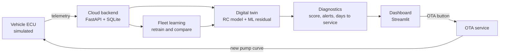

# Predictive Health Twin

**Vehicle Digital Twin & Predictive Diagnostics for an EV battery and drive thermal system**

Built for the **SDV Hackathon @ NE-PS** (Challenge 1: Vehicle Digital Twin & Predictive Diagnostics).

> Tell the driver weeks ahead. Fix it over the air.


---

## Table of contents

1. [The problem](#the-problem)
2. [Our solution](#our-solution)
3. [SDV enablers demonstrated](#sdv-enablers-demonstrated)
4. [Architecture](#architecture)
5. [Features](#features)
6. [Tech stack](#tech-stack)
7. [Quick start](#quick-start)
8. [Demo walkthrough](#demo-walkthrough)
9. [Project structure](#project-structure)
10. [API reference](#api-reference)
11. [How it works](#how-it-works)
12. [Testing](#testing)
13. [Limitations and validation plan](#limitations-and-validation-plan)
14. [Roadmap](#roadmap)
15. [Team](#team)
16. [License](#license)

---

## The problem

Thermal problems in an EV powertrain, such as a worn coolant pump, usually show up only when a warning light comes on. By then the driver faces a breakdown or an expensive, unplanned workshop visit, and the OEM carries the warranty cost.

## Our solution

**Predictive Health Twin** is a cloud-connected digital twin of the battery and drive thermal system.

1. A **virtual sensor** estimates a hidden temperature (cell temperature) from the signals the vehicle already sends.
2. The twin predicts what a **healthy** vehicle would do under the same load. The gap between expected and measured behavior reveals early degradation.
3. A **diagnostics engine** turns that gap into a **health score (0 to 100)** and a **days-to-service estimate**, with a plain-language explanation.
4. When risk is detected, an **OTA update** (adjusted pump curve and a mild derate) is pushed to the vehicle, and the dashboard shows health recovering.
5. The **fleet** shares data so the model keeps improving and false alarms (for example, on hot days) are suppressed.

**Customer value:** fewer breakdowns, lower service and warranty cost, and a better ownership experience, because the problem is fixed by software before the driver notices.

## SDV enablers demonstrated

The hackathon asks for the ECU function combined with at least two SDV enablers. This project combines **five**:

| Enabler | Where it appears |
|---|---|
| Connectivity / cloud | Vehicles post telemetry to a FastAPI cloud backend |
| Fleet / vehicle data | Fleet comparison separates real faults from weather effects |
| OTA and upgradability | A fix is pushed from the dashboard and applied by the vehicle |
| Continuous learning | The model is retrained on fleet data and versioned |
| Personalization | Per-vehicle baseline and health tracking |

## Architecture



Detailed design: [`docs/architecture.md`](docs/architecture.md)

## Features

- Fleet simulator: 20 vehicles over 30 days, including 3 with a degrading coolant pump
- Digital twin: physics-based thermal model with an ML correction (virtual cell temperature sensor)
- Predictive diagnostics: anomaly alerts, health score, status (green, amber, red), days-to-service range
- Plain-language explanations for every alert
- Cloud backend with a documented REST API
- Live dashboard: fleet overview, vehicle detail, twin vs. measured chart, health trend
- OTA update demo with before/after comparison and an OTA log
- Continuous learning: model versions (v1, v2) with a metrics comparison
- Replay mode that streams simulated days so the dashboard updates live

## Tech stack

| Area | Technology |
|---|---|
| Language | Python 3.11 |
| Backend | FastAPI, Uvicorn |
| Storage | SQLite |
| ML and data | scikit-learn, NumPy, pandas |
| Dashboard | Streamlit, Plotly |
| Tests | pytest |

## Quick start

**Prerequisites:** Python 3.11 and Git. No internet is needed after installation.

```bash
# 1. Clone
git clone https://github.com/<your-org>/predictive-health-twin.git
cd predictive-health-twin

# 2. Install
python -m venv .venv
source .venv/bin/activate        # Windows: .venv\Scripts\activate
pip install -r requirements.txt

# 3. Run everything (backend, model training if needed, dashboard)
./run.sh
```

Then open the dashboard at **http://localhost:8501** and the API docs at **http://localhost:8000/docs**.

To start from a clean state: `./run.sh --reset`

> Note: replace `<your-org>` with your GitHub account or organization. The commands above reflect the planned setup; update them if your final script names differ.

## Demo walkthrough

A 3-minute path through the project (full script in [`docs/demo_script.md`](docs/demo_script.md)):

1. **Fleet view:** 20 vehicles are streaming in; three show amber or red.
2. **Vehicle detail:** open the worst vehicle; the twin estimate and measured temperature diverge, and an alert explains why with a days-to-service range.
3. **OTA:** click the OTA button; the config version changes and the health score recovers.
4. **Fleet learning:** open the model panel to see the model version and its error improving.

## Project structure

```
predictive-health-twin/
  README.md
  instructions.md           # phased build plan for AI coding tools
  requirements.txt
  run.sh
  config.yaml               # all tunable numbers
  docs/                     # architecture, demo script, screenshots
  src/
    common/                 # config and shared schemas
    simulator/              # vehicle physics, driving cycles, fleet
    twin/                   # thermal model, ML residual, training
    diagnostics/            # anomaly detection, health score
    backend/                # FastAPI app, database, OTA
    dashboard/              # Streamlit app
  models/                   # saved, versioned models
  data/                     # generated data and SQLite database
  tests/
```

## API reference

Interactive docs are available at `/docs` when the backend is running.

| Method | Endpoint | Purpose |
|---|---|---|
| POST | `/telemetry` | Ingest a batch of vehicle telemetry |
| GET | `/fleet` | All vehicles with score, status and days to service, worst first |
| GET | `/vehicle/{id}` | Vehicle detail with history for charts and the explanation text |
| GET | `/vehicle/{id}/config` | Current control parameters (the vehicle downloads these) |
| POST | `/ota/{id}` | Push an OTA update to a vehicle |
| POST | `/model/retrain` | Retrain the twin on fleet data |
| GET | `/model/info` | Active model version and metrics |
| GET | `/health` | Liveness check |

## How it works

**1. Simulation.** A lumped thermal model (battery cell node and coolant node) generates "true" behavior. Three vehicles suffer a gradual coolant pump efficiency loss. Sensor noise and a few missing samples are added.

**2. Digital twin.** The same RC structure with healthy nominal parameters predicts expected coolant and cell temperatures. A scikit-learn model learns the remaining error, trained on healthy vehicles only. The result is a virtual cell temperature sensor.

**3. Diagnostics.** The daily residual (measured minus expected) is compared against thresholds and against the fleet median, so hot weather does not cause false alarms. The residual maps to a health score, and a trend fit gives a days-to-service range.

**4. OTA loop.** The dashboard pushes a new parameter set. The vehicle polls its config, applies it, and the residual drops, which is visible on the charts.

**5. Continuous learning.** Retraining on fleet data produces a new model version. It is promoted only if it beats the previous version on the same validation set.

## Testing

```bash
pytest
```

Key checks include reproducible simulation, twin error on healthy vehicles, early detection of all faulty vehicles with minimal false alarms, API behavior, and the OTA improvement.

Target metrics (to be confirmed by the final run):

| Metric | Target |
|---|---|
| Cell temperature estimate error (MAE, healthy vehicles) | under 2 C |
| Faulty vehicles flagged before reaching red | 3 of 3 |
| False alarms on healthy vehicles | at most 1 |

## Limitations and validation plan

Please read these before judging the results.

- **All data is simulated.** No real vehicle data was used. Accuracy numbers describe the simulation, not real-world performance.
- **Simplified physics.** The thermal model is a small lumped network, not a full vehicle model.
- **OTA is simulated.** There is no signing, secure boot or real vehicle communication.
- **Scope is one subsystem:** battery and drive thermal management.

**How we would validate with real vehicles:**

1. Collect real drive and charge logs from a test fleet with a reference cell temperature sensor.
2. Fit the thermal parameters and retrain the residual model on real healthy data.
3. Replay historical fault cases to measure detection lead time and false alarm rate.
4. Run the OTA change through a standard safety and release process before any field use.

## Roadmap

- [ ] Fleet-aware false alarm suppression on hot-weather days
- [ ] Business value card (avoided breakdowns and workshop visits, with clearly labeled assumptions)
- [ ] Safe OTA flow with pre-check and rollback
- [ ] Driver-facing notification view
- [ ] Natural-language assistant ("Why is EV-11 amber?")
- [ ] Validation with real vehicle logs

## Team

| Name | Role |
|---|---|
| [Name] | [Role] |
| [Name] | [Role] |
| [Name] | [Role] |

## Acknowledgements

Built for the **SDV Hackathon @ NE-PS** knowledge series. Developed with AI coding assistance; all code is generated, run and tested by AI tools under human direction.

## License

[Choose a license, for example MIT, and add a `LICENSE` file.]
